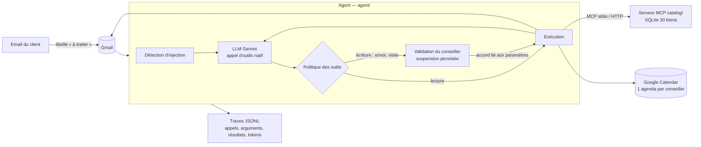

# Sama Kër Immobilier — agent IA de traitement des demandes de location

Agent qui lit les demandes reçues dans Gmail, cherche les biens dans le catalogue (serveur MCP),
consulte les agendas Google des conseillers, prépare une réponse **validée par un conseiller avant
tout envoi**, puis inscrit la visite dans l'agenda quand le client confirme (nouvelle validation).

| Dossier | Contenu | Responsable |
|---|---|---|
| [`agent/`](agent/README.md) | agent (LangGraph), prompt, boucle d'outils, état, validation humaine, CLI, évaluation | Massamba (partie 1) |
| [`catalog/`](catalog/) | base SQLite de 30 biens fictifs + serveur MCP (FastMCP) + évaluation de la recherche | Alassane (partie 2) |
| [`google_integration/`](google_integration/README_GOOGLE.md) | outils Google Calendar (un agenda par conseiller) et Gmail (brouillons, envoi, libellés) | Baye Serigne (partie 3) |

## Architecture



* Chaque action passe par un outil ; chaque écriture (envoi d'email, création / déplacement /
  annulation de visite) suspend l'agent jusqu'à l'accord d'un conseiller. L'accord est lié à l'action,
  à ses paramètres et au texte exact du brouillon : s'ils changent, il faut un nouvel accord.
* L'état de chaque conversation est conservé par fil Gmail (checkpoint SQLite) : une réponse du client
  reprend là où on s'était arrêté, même après un redémarrage.
* Le contenu des emails est traité comme une donnée ; les demandes hors périmètre (négociation,
  réclamation, litige, injection) sont transmises à un conseiller.

## Prérequis

* Python 3.11+ (testé en 3.12), macOS / Linux / Windows.
* Une clé API Gemini gratuite (<https://aistudio.google.com/apikey>) — ou un modèle Ollama local.
* Un **compte Google de test** réservé à l'atelier (jamais un compte personnel).

## Installation

```bash
git clone https://github.com/massamba0809/sama-ker-immobilier.git && cd sama-ker-immobilier
python3 -m venv agent/.venv && source agent/.venv/bin/activate     # Windows : agent\.venv\Scripts\activate
pip install -r agent/requirements.txt -r catalog/requirements.txt
cp agent/.env.example agent/.env                                   # puis renseigner GOOGLE_API_KEY
```

## Configuration des accès Google (une fois)

1. Sur <https://console.cloud.google.com> (connecté avec le compte de test) : créer un projet, activer
   **Gmail API** et **Google Calendar API**.
2. Écran de consentement OAuth : type « Externe », mode « Test », ajouter l'adresse du compte de test dans
   **Utilisateurs test**.
3. Identifiants → **ID client OAuth** de type **Application de bureau** → télécharger le JSON et le
   placer en `google_integration/credentials.json`.
4. Autoriser l'application (ouvre le navigateur ; crée `google_integration/token.json`) :
   ```bash
   python google_integration/auth.py
   ```
5. Créer les agendas des trois conseillers (noms fictifs) :
   ```bash
   python google_integration/setup_conseillers.py
   ```
6. Dans Gmail (compte de test) : créer le libellé **« à traiter »** et un filtre
   « À : <adresse du compte> → Appliquer le libellé : à traiter », pour que chaque nouvelle demande soit
   prise en charge automatiquement.

`credentials.json` et `token.json` sont ignorés par Git ; aucun identifiant n'est dans le dépôt.
Portées OAuth : `gmail.modify`, `gmail.compose`, `calendar`.

## Configuration de l'agent (`agent/.env`)

```ini
GOOGLE_API_KEY=...                       # clé Gemini
LLM_MODEL=gemini-3.1-flash-lite
TOOLS_MODE=integrated                    # mock (tout simulé) | hybrid | integrated (tout réel)
MCP_TRANSPORT=stdio
MCP_COMMAND=.venv/bin/python             # Python où `mcp` est installé (Windows : .venv\Scripts\python)
MCP_ARGS=-m catalog.server
GOOGLE_TOOLS_MODULE=google_integration.google_tools
```

Le détail de chaque variable est dans [`agent/.env.example`](agent/.env.example).

## Lancer

```bash
cd agent
python -m sama_agent.cli inbox --watch 30   # démo : traite chaque email « à traiter », validation au terminal
python -m sama_agent.cli inbox              # un seul passage
python -m sama_agent.cli pending            # reprendre les validations en attente (après redémarrage)
```

Pour chaque action sensible, le terminal affiche l'outil, ses paramètres et le texte exact de l'email,
puis attend `o` (oui), `n` (non) ou une consigne (refus avec consigne : l'agent propose une version
corrigée, à revalider).

Traces : `agent/traces/<fil Gmail>.jsonl` (chaque appel LLM avec ses tokens, chaque appel d'outil avec
ses arguments et son résultat, chaque demande de validation et décision).

## Serveur MCP du catalogue

```bash
python -m catalog.server                 # transport local (stdio)
python -m catalog.server --http          # HTTP : http://127.0.0.1:8000/mcp
npx @modelcontextprotocol/inspector python -m catalog.server   # inspecteur MCP (Node.js requis)
```

| Outil / ressource | Arguments | Retour |
|---|---|---|
| `rechercher_biens` | `quartier?`, `type?`, `budget_max?` (F CFA, inclusif), `pieces?` ou `pieces_min?`/`pieces_max?`, `disponible?` (défaut `true`), `limit?` | `{ok, biens:[{id, type, quartier, loyer, pieces, adresse, disponible}], count}` ; aucun résultat ⇒ `count: 0` |
| `detail_bien` | `bien_id` (ex. `SK-013`) | `{ok, bien}` ou `{ok: false, error}` |
| `agence://sama-ker-immobilier` | — | horaires de visite, zones couvertes, conditions de location |

Exemple : `rechercher_biens(quartier="Sacré-Cœur", pieces=3, budget_max=350000)` → `SK-013`, 350 000 F,
« Sacré-Cœur 3, Dakar ». La recherche ignore la casse et les accents (« sacre coeur »).
La base est créée au premier lancement (`catalog/data/catalogue.sqlite3`, ou `CATALOG_DB_PATH`).

## Tests et évaluation

```bash
cd agent && python -m pytest                    # agent + module Google (faux Google), sans réseau
python -m pytest ../catalog/tests               # catalogue
python -m evaluation.run                        # exercice 6 : 15 emails, avant/après correction (clé Gemini)
cd .. && python -m catalog.evaluation.evaluate  # recherche du catalogue sur 15 demandes
```

Résultats de l'évaluation de l'agent et analyse des échecs : [`agent/evaluation/resultats.md`](agent/evaluation/resultats.md).
Traces de traitements complets réels : [`agent/docs/traces_reelles/`](agent/docs/traces_reelles/).

## Sécurité

* Aucun email ne part et aucune visite n'est créée, déplacée ou annulée sans l'accord explicite d'un
  conseiller ; une écriture n'est considérée comme faite que si l'outil renvoie son identifiant.
* L'agent ne répond qu'à partir des outils (catalogue, agenda) ; il ne cite aucun bien, prix ou créneau
  qui n'y figure pas.
* Secrets hors du dépôt (`.env`, `credentials.json`, `token.json` dans `.gitignore`).
